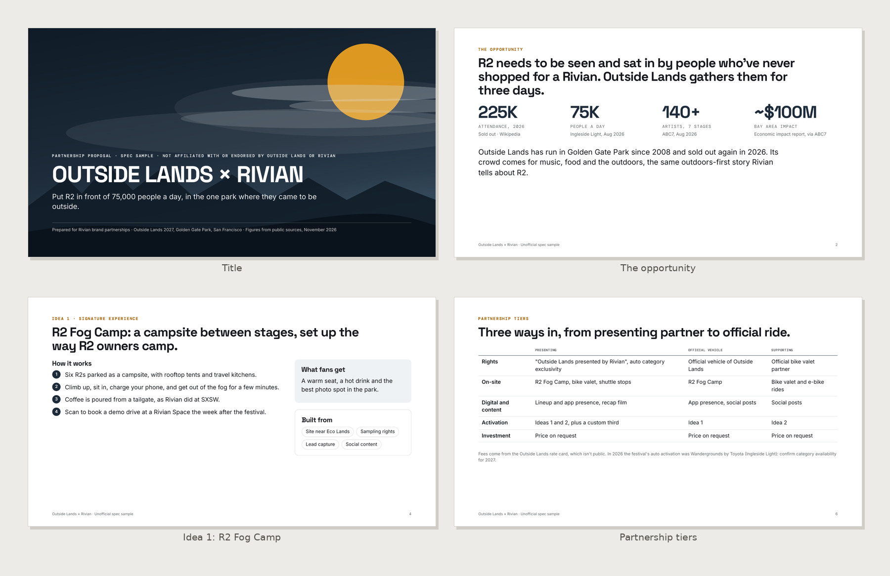
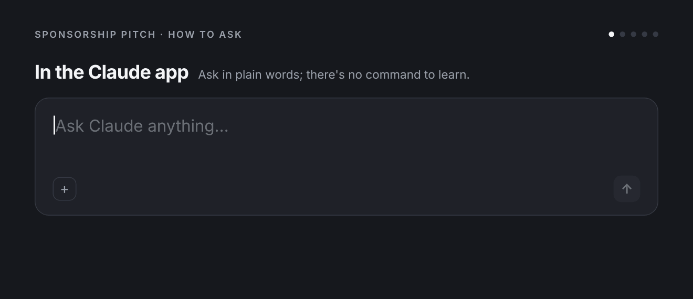

# Sponsorship Pitch

Turn "brand + property" into a partnership pitch a sales team could walk into a meeting with: why this brand, why now, who the property reaches, three activation ideas, tiered packages, measurement, timeline, and next steps. The deck is a 16:9 PDF in the property's colors and type, with a speaker notes file and, on request, a two-page leave-behind.

**What you get:** Builds a sponsorship or brand partnership pitch deck as a designed 16:9 PDF with speaker notes, from a brand and a property (venue, event, team, league, festival, tour, creator, platform or media property). Researches both sides, shows why they fit, proposes activation ideas, packages partnership tiers, and lays out how results will be measured.



**See the full sample:** [Sample-Outside-Lands-x-Rivian-Partnership-Pitch.pdf](examples/Sample-Outside-Lands-x-Rivian-Partnership-Pitch.pdf) (an unofficial spec sample with real brands and sourced figures; not affiliated with or endorsed by Outside Lands or Rivian)

Made by Beautiful Engine · [beautifulengine.com](https://www.beautifulengine.com) · [Questions or ideas? Open an issue](https://github.com/BeautifulEngine/sponsorship-pitch/issues/new)

## Install

### Claude app (web or desktop)

1. Download **[sponsorship-pitch.zip](sponsorship-pitch.zip)** from this repo (open the file, then use the download button). Don't unzip it.
2. Turn on **Settings > Capabilities > "Code execution and file creation"**.
3. Go to **Customize > Skills**, click **+**, then **+ Create skill > Upload a skill**, and upload the zip.
4. Start a new chat and ask in plain words. Claude picks the skill up on its own.

> GitHub's green "Code > Download ZIP" button won't work for this; it wraps everything in an extra folder. Use `sponsorship-pitch.zip`.

### Claude Code

As part of the Beautiful Engine collection (you get updates and the other skills):

```bash
claude plugin marketplace add BeautifulEngine/skills
claude plugin install beautiful-engine@beautiful-engine
```

Then use `/beautiful-engine:sponsorship-pitch`, or ask in plain words. Or install just this one:

```bash
git clone https://github.com/BeautifulEngine/sponsorship-pitch.git
mkdir -p ~/.claude/skills && cp -r sponsorship-pitch/sponsorship-pitch ~/.claude/skills/
```

Then use `/sponsorship-pitch`.

## Usage



```
/sponsorship-pitch <brand> x <property> [budget or tier] [short] [leave-behind]
```

Plain requests work too:

- "Make a sponsorship deck pitching Oatly on our summer concert series." (attach a rate card or asset list if you have one)
- "Partnership pitch: Rivian x Outside Lands."
- "I'm a creator with 400K followers. Pitch Liquid Death on a sponsorship."
- "Package our venue's assets into three sponsor tiers for a bank."
- Add "short" for an 8-slide version, or "leave-behind" for a two-page summary PDF too.

**Direction.** By default the property is pitching the brand (a sales or partnerships team selling sponsorship). If the person is on the brand or agency side proposing to a property, flip the framing: the deck sells the idea to the property, and tiers become "what we'd want" rather than "what we offer". Say which direction you took.

**Files.** `<skill-dir>` means this skill's folder, the one holding this SKILL.md. Templates are in `assets/`, scripts in `scripts/`, and the shared PDF steps (fonts, colors, render, check) are in `references/rendering.md`.

## When Claude uses it

Someone asks for a sponsorship deck, partnership proposal, sponsor pitch, rights package, or help pitching a brand on a sponsorship.

## How it works

```
sponsorship-pitch/
├── SKILL.md
├── assets/  base.css, deck.css, pitch-template.html
├── scripts/  audit.js, contact_sheet.py, fonts.py, render.cjs, render.py, tokens.py
├── references/  brand-extraction.md, rendering.md
```

PDFs are built from HTML templates, colored and typeset with the right brand, rendered by headless Chrome, then checked for fonts, text contrast and leftover blanks before delivery. Anything with numbers in it is calculated by a script, not estimated.

## Works well with

- [Company Brief](https://github.com/BeautifulEngine/company-brief)
- [Activation Concepts](https://github.com/BeautifulEngine/activation-concepts)
- [Project Quote](https://github.com/BeautifulEngine/project-quote)
- [All Beautiful Engine skills](https://github.com/BeautifulEngine/skills)

## Made by Beautiful Engine

Sponsorship Pitch is made by [Beautiful Engine](https://www.beautifulengine.com), a creative studio in Los Angeles working across brand, experiential and interactive design.

- **Website:** [beautifulengine.com](https://www.beautifulengine.com)
- **Questions, ideas, or something broke?** [Open an issue](https://github.com/BeautifulEngine/sponsorship-pitch/issues/new) and describe what you asked for and what happened.

This repo is published from [BeautifulEngine/skills](https://github.com/BeautifulEngine/skills); changes are made there and copied here.

## License

MIT. See [LICENSE](LICENSE).

